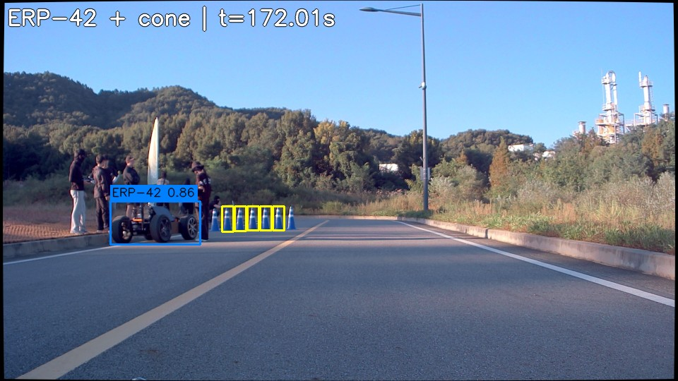
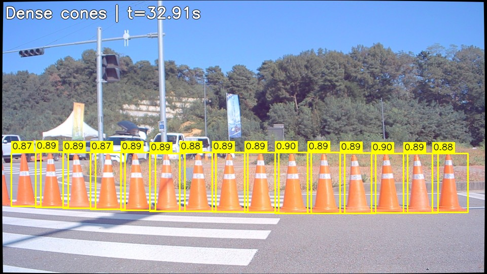
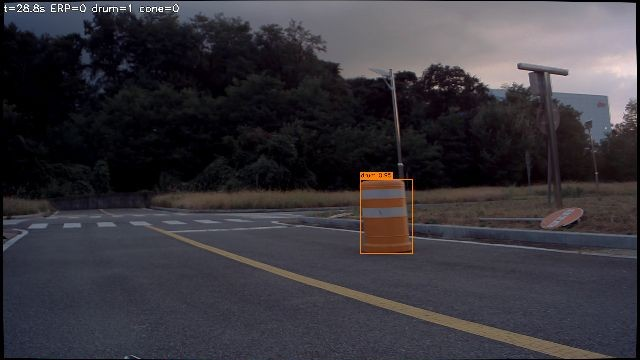
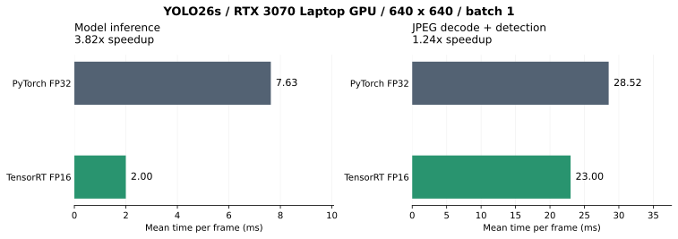
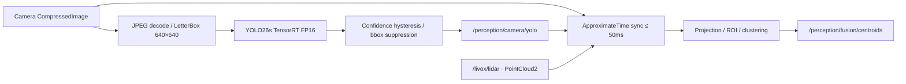

# 2026 Clothoid-R Perception · YOLO26 TensorRT

Clothoid-R의 ROS1 perception workspace입니다. 카메라에서 **ERP-42·drum·cone**을 검출하고 Livox LiDAR와 결합해 객체의 2D 중심 좌표를 발행합니다. 기본 모델은 **YOLO26s + TensorRT FP16**, 입력은 **batch 1 / 640 × 640**입니다.

RTX 3070 Laptop GPU에서 현재 보관 중인 bag으로 측정한 모델 추론 시간은 PyTorch FP32 **7.63ms → TensorRT FP16 2.00ms**, 약 **3.82배** 빨라졌습니다.

## 실제 검출 예시

| ERP-42 + cone | cone | drum |
|:---:|:---:|:---:|
|  |  |  |

## TensorRT 성능



| 백엔드 | 모델 추론 평균 | 디코딩+검출 평균 | 평균 시간 환산 FPS |
|---|---:|---:|---:|
| PyTorch FP32 | 7.63ms | 28.52ms | 35.06 |
| TensorRT FP16 | 2.00ms | 23.00ms | 43.48 |

동일 240프레임 × 3회, batch 1, 입력 640×640, 모델별 30회 워밍업 기준입니다. FPS는 디코딩+검출 시간의 역수이며 ROS 전송·fusion·화면 표시·MP4 인코딩은 제외합니다. mAP와 FP16 정확도 손실은 미측정입니다. [측정 조건·JSON·CSV](docs/performance.md)에 원본 결과를 남겼습니다.

## Pipeline



## TensorRT 엔진 생성

archive에는 원본 `.pt`를 포함하고 ONNX와 engine은 대상 GPU에서 다시 만듭니다.

```bash
python yolo26/build_trt_engine.py \
  --weights src/yolo26/models/small.pt \
  --imgsz 640 --batch 1 --fp16 --workspace 4
```

| 산출물 | 의미 |
|---|---|
| `src/yolo26/models/small.onnx` | FP32 ONNX, 정적 입력 `[1,3,640,640]` |
| `src/yolo26/models/small_fp16.engine` | FP16 연산을 허용한 TensorRT engine |
| `src/yolo26/models/small_fp16.engine.layers.json` | 최적화 이후 레이어·정밀도·tactic 정보 |

`--fp16`은 TensorRT 정밀도 옵션이며 `--half`는 ONNX 자체를 FP16으로 export하는 별도 옵션입니다. 기본 경로는 FP32 ONNX → TensorRT FP16입니다. [구현과 최적화 결과](docs/tensorrt.md)를 참고하세요.

## 실행

```bash
# YOLO26 + fusion
roslaunch perception_bringup perception.launch \
  yolo_python:="$(command -v python)"

# 카메라 검출만
roslaunch yolo26 yolo_detect.launch python:="$(command -v python)"

# fusion만, 카메라 bbox는 외부 노드나 bag에서 공급
roslaunch perception_bringup perception.launch run_yolo:=false
```

기본 launch는 GUI·프레임별 로그를 끕니다. 화면은 `show_detection_image:=true`, 검출 로그는 `print_detections:=true`로 켭니다.

```bash
roslaunch perception_bringup perception.launch \
  yolo_python:="$(command -v python)" \
  engine_weights:="$(pwd)/src/yolo26/models/small_fp16.engine" \
  camera_image_topic:=/camera/image_raw/compressed \
  livox_lidar_topic:=/livox/lidar
```

## 토픽과 검출 조건

| 토픽 | 타입 | 용도 |
|---|---|---|
| `/camera/image_raw/compressed` | `sensor_msgs/CompressedImage` | 카메라 입력 |
| `/livox/lidar` | `sensor_msgs/PointCloud2` | LiDAR 입력 |
| `/perception/camera/yolo` | `detect_msgs/Yolo_Objects` | 원본 이미지 픽셀 bbox |
| `/perception/fusion/centroids` | `sensor_msgs/PointCloud` | pitch 보정 좌표의 `(x,y,0)` 중심 |
| `/perception/fusion/filtered_cloud` | `sensor_msgs/PointCloud2` | 디버깅용 포인트 |

세 클래스 모두 publish합니다. 기본 진입 confidence **0.5**, 유지 confidence **0.3**, 이전 bbox 매칭 IoU **0.3**입니다. 추가 억제는 클래스별 NMS IoU **0.5**, containment IoA **0.8**입니다. YOLO 메시지의 `id`는 프레임 내 순번이며 지속적인 tracking ID가 아닙니다. confidence는 현재 메시지에 포함하지 않습니다.

- [YOLO 파라미터](src/yolo26/README.md)
- [fusion 알고리즘·좌표·현재 제한](src/livox_camera_fusion/README.md)
- [통합 launch 인자](src/perception_bringup/README.md)
