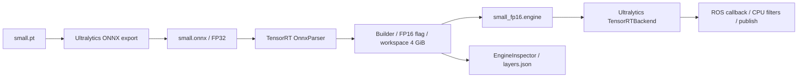

# TensorRT 적용 방식

## 변환과 실행

현재 `small.pt`는 YOLO26s, 3 classes, `end2end=True`이며 클래스는 `{0: ERP-42, 1: drum, 2: cone}`입니다.



`yolo26/build_trt_engine.py`가 두 단계를 수행합니다.

1. 저장소의 Ultralytics 포크에서 `YOLO(weights).export(format="onnx")`를 호출합니다. 기본값은 `imgsz=640`, `batch=1`, `dynamic=False`, `half=False`, `simplify=False`입니다. GPU가 있으면 export를 `device="0"`에서 수행해 후속 빌드의 CUDA 가시성을 유지합니다.
2. TensorRT Python API의 `OnnxParser`로 그래프를 읽고 `BuilderConfig`에 workspace 4GiB와 `BuilderFlag.FP16`을 설정합니다. `build_serialized_network()`로 engine을 저장하고 `EngineInspector`의 상세 정보를 JSON으로 기록합니다.

ROS Python 노드는 `YOLO(engine_weights, task="detect")`로 engine을 엽니다. `ultralytics/nn/backends/tensorrt.py`가 역직렬화·CUDA 입출력 buffer·`execute_v2()`를 담당합니다. 이미지 디코딩과 추가 bbox 필터는 CPU 쪽에 남아 있습니다.

## 실제 확인한 결과

2026-10-13 기존 `small.onnx`와 `small_fp16.engine`을 확인했습니다.

| 항목 | 값 |
|---|---|
| ONNX / engine 입력 | `images`, `[1,3,640,640]`, FP32 |
| engine 출력 | `output0`, `[1,300,6]`, FP32 |
| ONNX 노드 수 | 452 |
| TensorRT Inspector 레이어 | 217, Reformat·NoOp 등 포함 |
| Inspector 출력 tensor datatype 표기 | Half 219 / Float 1 / Int32 2 / Int64 1 |
| 첫 레이어 | Float 입력 → Half Reformat → Half convolution |

출력 tensor 수와 레이어 수는 서로 다른 지표입니다. 452 → 217은 그래프 표현의 차이이며 그 자체를 연산량 감소율로 해석하지 않습니다. 첫 convolution tactic에는 `sm80_xmma...f16...tensor16x8x16`이 기록되어 있어 실제 Half 가중치·연산과 선택한 GPU tactic을 확인할 수 있습니다.

FP16 플래그는 FP16 사용을 **허용**합니다. 현재 engine I/O는 FP32이며 내부에는 Half와 Float 등이 섞입니다. NVIDIA의 [정밀도 제어 문서](https://docs.nvidia.com/deeplearning/tensorrt/10.x.x/inference-library/precision-control.html)를 참고하세요.

## 재생성

```bash
conda activate yolotrt
python yolo26/build_trt_engine.py --fp16             # .pt → ONNX → FP16 engine
python yolo26/build_trt_engine.py --skip-onnx --fp16 # 기존 ONNX 재사용
python yolo26/build_trt_engine.py --skip-engine      # ONNX까지만

# 같은 YOLO26s의 TensorRT FP32 비교용 engine
python yolo26/build_trt_engine.py --skip-onnx \
  --engine src/yolo26/models/small_fp32.engine
```

`nano_fp32.engine`은 다른 크기의 모델이므로 `small_fp16.engine`과 비교해서 FP16 자체의 효과로 해석할 수 없습니다. 현재 성능표는 동일 YOLO26s의 **PyTorch FP32 vs TensorRT FP16**입니다.

| 옵션 | 의미 |
|---|---|
| `--fp16` | TensorRT FP16 허용, ONNX는 기본 FP32 |
| `--half` | ONNX 자체를 FP16으로 export |
| `--workspace 4` | 빌드 workspace 한도, GiB |
| `--dynamic --max-batch 8` | 동적 profile, 기본 min/opt/max batch 1/4/8 |
| `--simplify` | `onnxslim` 사용, 별도 설치 필요 |
| `--int8` | INT8 플래그만 설정, calibration/Q-DQ 미구현 |

기본 ROS 실행은 정적 batch 1 / 640 입력입니다. INT8는 검증된 배포 경로에 포함하지 않습니다.

현재 빌더는 version/hardware compatibility 옵션을 설정하지 않습니다. 원본 `.pt`를 배포하고 대상 GPU에서 재빌드합니다. NVIDIA의 [Engine Compatibility](https://docs.nvidia.com/deeplearning/tensorrt/latest/inference-library/engine-compatibility.html)에 호환 조건이 설명되어 있습니다. 기존 engine SHA-256은 [실측 JSON](../benchmarks/2026-10-13-rtx3070-small-objects.json)에 기록했습니다.
